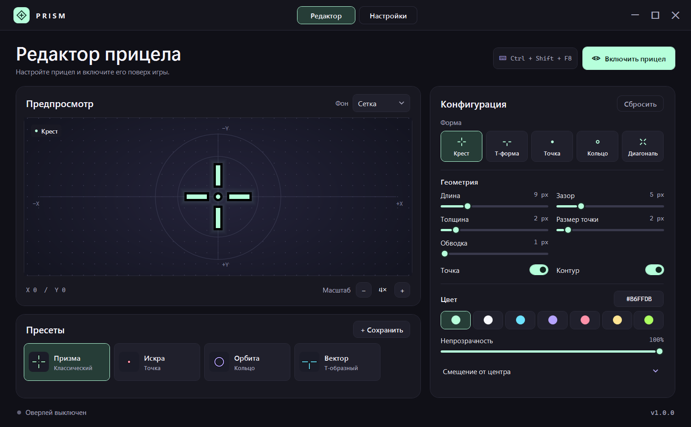

# Prism Crosshair

Настраиваемый прицел для Windows 10/11 x64.

[Скачать последнюю версию](https://github.com/senta12531-hash/prism-crosshair/releases/latest)

1. Распакуйте архив и запустите `Prism.exe`. Среда .NET уже входит в сборку.
2. Выберите пресет или настройте форму, размеры, цвет, контур, прозрачность и смещение.
3. Нажмите **Включить прицел** или **Ctrl + Shift + F8**. Комбинацию и монитор можно изменить в настройках.
4. Сверните Prism в трей, чтобы прицел оставался поверх игры. Двойной клик по значку трея откроет редактор.

Для игр используйте оконный или безрамочный режим. В эксклюзивном полноэкранном режиме Windows может скрывать наложение. Прицел — небольшое прозрачное окно Windows, которое пропускает клики. Оно обновляется при изменении настроек, монитора или активного окна.

Prism проверяет GitHub Releases при запуске и каждые четыре часа. Когда доступна новая версия, в редакторе появляется кнопка скачивания. Чтобы перейти на новую версию, закройте Prism через меню трея, распакуйте новый архив и замените предыдущий `Prism.exe`. Пресеты и настройки хранятся в `%LOCALAPPDATA%\Prism Crosshair\settings.json`.

## Сборка и выпуск

- `dotnet build -c Release` собирает приложение с .NET 8 SDK на Windows.
- `pwsh -File ./package.ps1` создаёт ZIP и SHA-256 в `dist/`.
- Чтобы выпустить обновление, измените `Version` в `Prism.csproj` и отправьте коммит на GitHub. Запустите `pwsh -File ./publish.ps1` с авторизованным GitHub CLI. Скрипт соберёт ZIP и опубликует релиз с номером версии из проекта.
